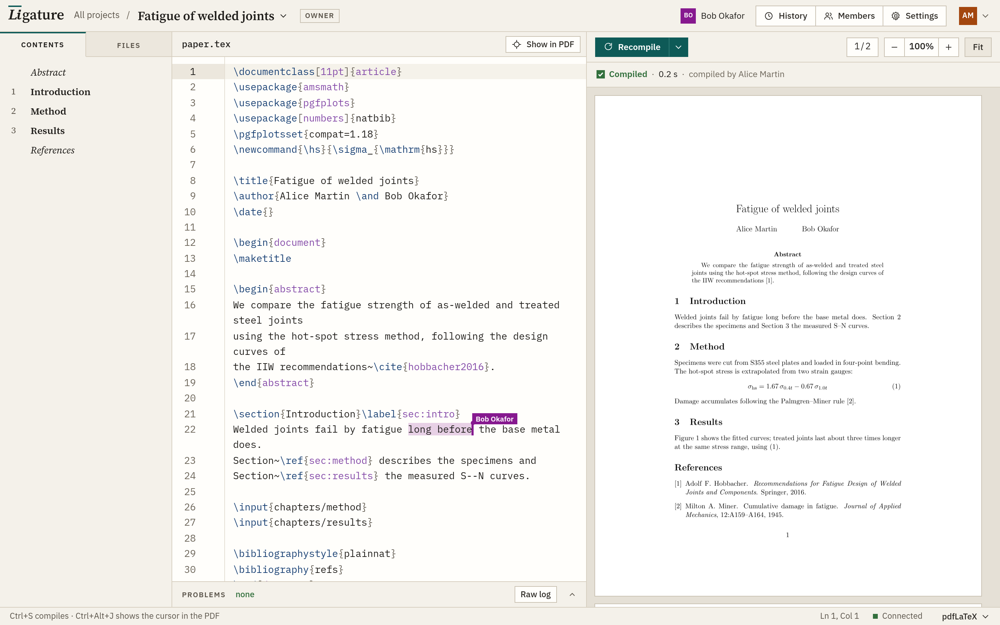
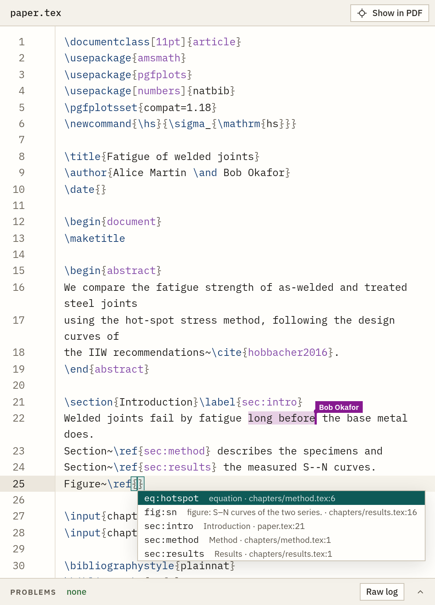
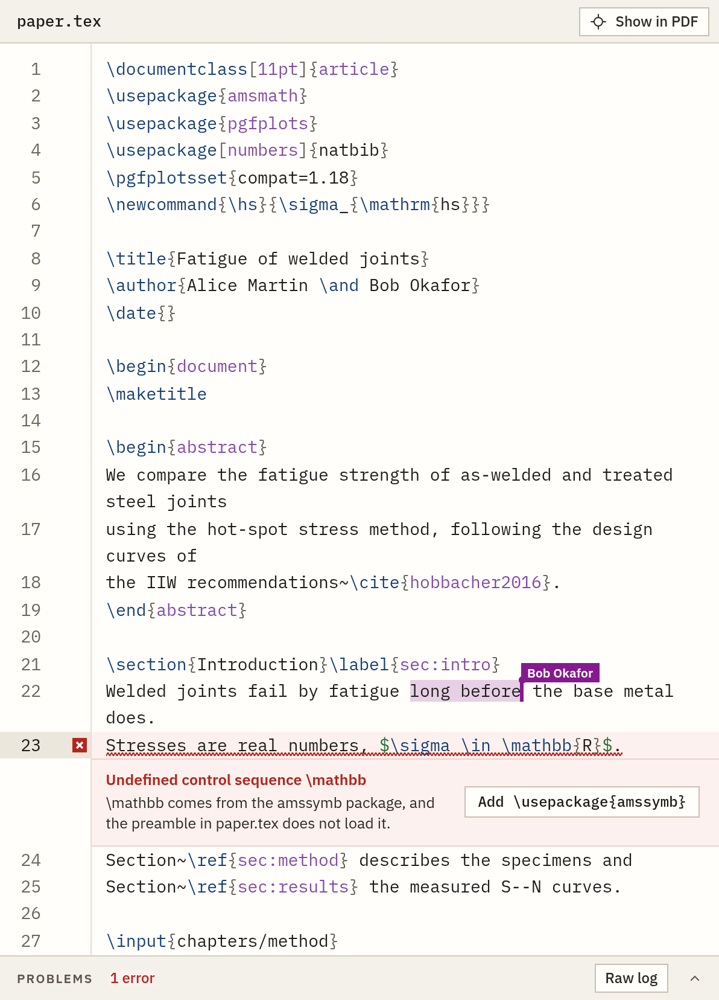

<p align="center">
  <picture>
    <source media="(prefers-color-scheme: dark)" srcset="docs/brand/ligature-wordmark-reversed.svg">
    
  </picture>
</p>

<p align="center">
  <strong>A self-hosted, real-time collaborative LaTeX editor for teams that write together.</strong>
</p>

<p align="center">
  <a href="https://github.com/Zoryc/Ligature/actions/workflows/ci.yml"></a>
  <a href="https://github.com/Zoryc/Ligature/releases"></a>
  <a href="LICENSE"></a>
</p>

<p align="center">
  <a href="#features">Features</a> ·
  <a href="#try-it">Try it</a> ·
  <a href="#run-it-on-your-server">Run it on your server</a> ·
  <a href="#documentation">Documentation</a> ·
  <a href="CHANGELOG.md">Changelog</a>
</p>

<p align="center">
  
</p>

Ligature is a LaTeX editor that runs in your browser and on **your own server**. Several people edit the same
document at the same time and see each other's cursors; the server compiles it with a real TeX Live, in a
sandbox, and shows the PDF next to the source. Your papers stay on a machine you control.

- **Collaborative by design:** live co-editing with presence and cursors, roles (owner, editor, viewer),
  invite links, full history with restore.
- **Made for writing LaTeX:** autocomplete for commands, labels and citations, go to definition, plain-language
  error explanations with one-click fixes, SyncTeX between source and PDF.
- **Easy to host:** two Docker containers you build yourself, a step-by-step guide, health checks, backups,
  an audit log. MIT licensed.

> [!WARNING]
> **Ligature was vibe coded** (written with an AI assistant) **and has not been audited.** It has a test suite
> and a sandbox, but no independent security or code review has been done. Use it at your own risk, keep
> backups, and do not expose it to people you do not trust.

## Features

### Write together

- **Real-time co-editing:** everyone types in the same document; each person's cursor and selection show with
  their name. If the connection drops, your edits are kept in the open tab and sent when it comes back.
- **Projects and roles:** owners, editors and viewers; invite people with a link that expires, can be limited
  to a number of uses and can be revoked; transfer ownership.
- **History:** automatic and named versions, side-by-side differences, restore a file or the whole project,
  and undo a restore.
- **Files:** folders, drag-and-drop uploads, zip import and export, a trash can to restore deleted files.

### Compile and fix

- **pdfLaTeX, XeLaTeX and LuaLaTeX** with the full TeX Live, compiled on the server; auto-compile a moment after
  you stop typing, or Ctrl+S.
- **Errors explained in plain words**, right under the line, with a one-click fix when a `\usepackage` is missing.
- **SyncTeX:** jump from the source to the PDF (Ctrl+Alt+J) and double-click the PDF to jump back.
- **Sandboxed compiles:** no network, one Unix user per project, read-only system, time, memory and disk
  limits, and a suite of malicious documents tested in CI.

<table>
  <tr>
    <td width="50%"></td>
    <td width="50%"></td>
  </tr>
  <tr>
    <td><b>Autocomplete</b> knows the project: <code>\ref{</code> lists every label of every file, <code>\cite{</code> every <code>.bib</code> entry.</td>
    <td><b>Errors explained</b> where they happen, with the fix one click away.</td>
  </tr>
</table>

### Find your way in long documents

- **Autocomplete** for about 600 commands and 80 environments (with argument placeholders and the matching
  `\end`), your own `\newcommand`s, labels, citation keys, files and packages.
- **Search in all files** (Ctrl+Shift+F) with Replace all, and **rename a label with F2**: its `\label` and every
  reference follow, in every file. Ctrl+Z undoes either one everywhere at once, keeping what co-authors typed since.
- **Go to definition:** Ctrl+click a `\ref`, a `\cite` key, an `\input` or `\includegraphics` file, or your own
  command or environment to jump to it.
- **Contents outline** of the whole document across files, with error and warning marks per section.

### Run your own server

- **Two containers**, built on your server from this repository: the app, and a compiler with no network.
  Add it to the reverse proxy you already use (Caddy and nginx configurations included).
- **Admin tools:** users, sign-up mode (invite only, open, closed), storage report, an audit log of who did what,
  account deletion.
- **Operations:** `/healthz` for uptime monitors, online backups and a validated restore (`ligature backup`,
  `ligature restore`), safe upgrades and rollback.

## Try it

**With Docker** (Linux, macOS or Windows with Docker Desktop, and Node 24+ for the helper script). This runs the
real production stack on your machine, behind a local Caddy:

```sh
git clone https://github.com/Zoryc/Ligature && cd Ligature
npm run stack -- up        # first build: 10 to 15 minutes (it downloads TeX Live)
```

Open <http://localhost:8080> and create the first account with the setup link the command prints; it becomes
the administrator. `npm run stack -- stop` stops it (your data is kept).

**For development** (Node 24+ and a TeX distribution with `latexmk`, e.g. [TinyTeX](https://yihui.org/tinytex/)):

```sh
npm install
npm start -w @ligature/compiler   # compile worker (development mode, no sandbox)
npm run dev:server                # API and collaboration server
npm run dev:web                   # web app on http://localhost:5173
```

Log in with one click as `alice` (owner and admin), `bob` (editor) or `carol` (viewer). To be two people at
once in one browser, open a second tab at <http://bob.localhost:5173>.

## Run it on your server

```
browser ──HTTPS + WebSocket──▶ your reverse proxy (Caddy, nginx, …)
                                  │ 127.0.0.1:3000
                                  ▼
                       ┌─ app ──────────────────────────────┐    volume data:
                       │ API · web app · live editing        │ ─▶ database, uploads,
                       │ the ligature command-line tool      │    PDFs, backups
                       └─────────────────┬───────────────────┘
                                         │ local socket
                                         ▼
                       ┌─ compiler ─────────────────────────┐    volume builds:
                       │ TeX Live · sandboxed compile worker │ ─▶ build folders, caches
                       │ no network at all                   │
                       └─────────────────────────────────────┘
```

```sh
sudo git clone https://github.com/Zoryc/Ligature /opt/ligature && sudo chown -R "$USER": /opt/ligature && cd /opt/ligature
cp docker/.env.example docker/.env                    # set LIGATURE_ORIGIN=https://latex.example.org
docker compose -f docker/compose.yaml up -d --build   # first build: 10 to 15 minutes
docker compose -f docker/compose.yaml exec app ligature create-admin alice
```

Then add Ligature as one site to your reverse proxy. The full guide for a fresh Ubuntu server covers requirements,
the proxy, sign-up modes, monitoring, backups, restore and upgrades: **[docker/README.md](docker/README.md)**.

> [!NOTE]
> Ligature is built for **a team that trusts each other** (a lab, a class, colleagues): keep sign-up on
> *invite only* or *closed* until the stronger gVisor sandbox is available. See [SECURITY.md](SECURITY.md).

## Documentation

| | |
|---|---|
| [docker/README.md](docker/README.md) | Deploying and running a server |
| [CHANGELOG.md](CHANGELOG.md) | Versions and what changed |
| [docs/PLAN.md](docs/PLAN.md) | Architecture, decisions and roadmap |
| [docs/AUTOCOMPLETE.md](docs/AUTOCOMPLETE.md), [docs/GO-TO-DEFINITION.md](docs/GO-TO-DEFINITION.md), [docs/RENAME-AND-REPLACE.md](docs/RENAME-AND-REPLACE.md), [docs/ACCOUNT-DELETION.md](docs/ACCOUNT-DELETION.md) | Feature specifications |
| [docs/M1.md](docs/M1.md) … [docs/M4.md](docs/M4.md) | Specification of each milestone (features and API) |
| [docs/SYNC.md](docs/SYNC.md) | Research behind the collaboration model |
| [docs/brand](docs/brand/README.md) | Logo and colours |

## Development

TypeScript everywhere: a [Svelte 5](https://svelte.dev) web app with [CodeMirror 6](https://codemirror.net) and
[PDF.js](https://mozilla.github.io/pdf.js/); a [Hono](https://hono.dev) server with
[Hocuspocus](https://tiptap.dev/docs/hocuspocus)/[Yjs](https://yjs.dev) for live editing and SQLite for storage;
a compile worker around `latexmk`.

| Path | What |
|---|---|
| `apps/web` | The web app: editor, PDF viewer, panels |
| `apps/server` | API, live-editing server, storage, history, compile orchestration, the `ligature` CLI |
| `apps/compiler` | Sandboxed compile worker |
| `packages/shared` | API types shared by all of the above |
| `packages/latex-log-parser` | TeX and latexmk logs turned into diagnostics |
| `packages/synctex` | SyncTeX lookups between the PDF and the source |
| `docker/` | Images, Compose files, proxy examples |

Tests run in Docker, on Linux with TeX Live, exactly as in CI:

```sh
npm run test:docker                 # typecheck, every test suite, web build
npm run test:docker -- server       # one workspace: server, web, compiler, shared, latex-log-parser, synctex
npm run test:docker -- sandbox      # the sandbox and the malicious-document suite, as root
```

`npm test` runs them directly on your machine too, but skips what needs Linux or root.

## Contributing and security

Issues and pull requests are welcome. Please report security problems privately, as described in
[SECURITY.md](SECURITY.md), not in a public issue.

## Licence

[MIT](LICENSE) © Zakari Piche.
The bundled fonts (IBM Plex Sans, IBM Plex Mono and Source Serif 4) are under the SIL Open Font License; the
logo's "gature" is traced from Source Serif 4 and its barred *Li* is drawn (see [docs/brand](docs/brand/README.md)).
